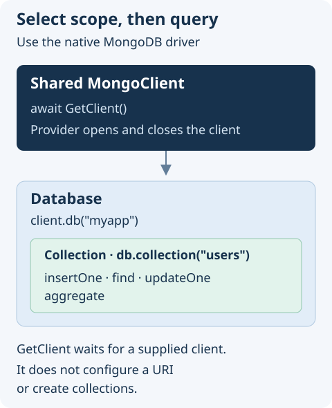

## Overview

Use the shared MongoDB connection without creating a client in every module. `GetClient()` returns the native [MongoClient](https://github.com/mongodb/node-mongodb-native). Queries, cursors, indexes, and transactions use the API of the MongoDB driver.

## Choose a database task

- [Read and write documents](#read-and-write-documents) for application records.
- [Aggregate records](#aggregation-pipelines) for grouped counts and reports.
- [Create indexes](#indexes) for query performance and uniqueness constraints.
- [Understand client ownership](#getclient) before you add connection or shutdown code.

{width="480"}

The interface does not configure a URI, start MongoDB, or define a data model. Before you run the examples, configure an implementing module and a reachable MongoDB deployment. The examples use the `myapp` database and the `users` collection. Use disposable data when you try writes.

## Getting started

Install the package in your project:

```bash
pnpm add @antelopejs/interface-mongodb
```

### Read a small result first

Run this function in an AntelopeJS module bound to a MongoDB provider. It selects at most ten documents and returns only their IDs and names. An empty array means that no document matched. A connection failure rejects the promise instead.

```typescript
import { GetClient } from "@antelopejs/interface-mongodb";

export async function listUserNames() {
  const client = await GetClient();
  return client
    .db("myapp")
    .collection("users")
    .find({}, { projection: { name: 1 } })
    .limit(10)
    .toArray();
}
```

`find()` builds a cursor and `toArray()` consumes it. Keep a limit on exploratory reads, so that a read does not load a whole collection into memory. Native MongoDB queries skip the model modifiers of `@antelopejs/interface-database-decorators`, such as hashing and encryption. They also skip the field access modes of `@antelopejs/interface-data-api`.

## `GetClient`

`GetClient()` returns the MongoDB client that the implementing module supplies. It is the entry point for every MongoDB operation.

```typescript
import { GetClient } from "@antelopejs/interface-mongodb";

async function example() {
  const client = await GetClient();
  // client is the MongoClient of the mongodb driver
}
```

The function returns a `Promise<MongoClient>` that the implementing module resolves. Until a module supplies a client, the promise stays pending. `GetClient()` does not probe the connection and has no timeout.

`@antelopejs/mongodb` supplies its client only in its default `owned` mode. It connects with its `url` and `options` configuration, then resolves the promise. An instance in `external` mode never supplies a client, so the project lists `@antelopejs/interface-mongodb` in the `disabledExports` of that instance. When AntelopeJS destroys the `@antelopejs/mongodb` module, the module closes the client and replaces the promise with a pending one. A later `GetClient()` call then waits for the next connection, and a client that you kept from before is closed. Call `GetClient()` where you use the client instead of keeping the client from module load.

Treat the client as shared. The provider opens and closes it, so do not call `close()` after a query. Select the database by name with `client.db("myapp")`. `client.db()` without a name uses the database of the connection string, not the `database` option of `@antelopejs/mongodb`. Use the error handling and timeout options of the driver for each operation.

`client.db("myapp").collection("users")` returns a `Collection<Document>`. `Document` types every field as `any`, so TypeScript checks no field name or value in the examples on this page. To type the fields, pass a type argument, as in `collection<User>("users")`. The driver does not check stored documents against that type.

## Read and write documents

Use the client to reach databases and collections, then create, read, update, and delete documents.

### Insert documents

```typescript
import { GetClient } from "@antelopejs/interface-mongodb";

async function createUser(name: string, email: string) {
  const client = await GetClient();
  const db = client.db("myapp");
  const collection = db.collection("users");

  const result = await collection.insertOne({
    name,
    email,
    createdAt: new Date(),
  });
  return result.insertedId;
}
```

### Find documents

```typescript
import { GetClient } from "@antelopejs/interface-mongodb";

async function findUsersByRole(role: string) {
  const client = await GetClient();
  const db = client.db("myapp");
  const users = db.collection("users");

  return users.find({ role }).toArray();
}
```

### Update documents

```typescript
import { GetClient } from "@antelopejs/interface-mongodb";

async function updateEmail(userId: string, newEmail: string) {
  const client = await GetClient();
  const db = client.db("myapp");
  const users = db.collection("users");

  const { ObjectId } = await import("mongodb");
  const result = await users.updateOne(
    { _id: new ObjectId(userId) },
    { $set: { email: newEmail, updatedAt: new Date() } },
  );
  return { matched: result.matchedCount, modified: result.modifiedCount };
}
```

For an acknowledged write, `matchedCount` tells you whether the record exists. `modifiedCount` alone does not. Validate an external ID before you construct an `ObjectId`, because the constructor throws on a malformed value. This example uses ObjectIds that MongoDB generates, not string `_id` values.

### Delete documents

```typescript
import { GetClient } from "@antelopejs/interface-mongodb";

async function deleteUser(userId: string) {
  const client = await GetClient();
  const db = client.db("myapp");
  const users = db.collection("users");

  const { ObjectId } = await import("mongodb");
  const result = await users.deleteOne({ _id: new ObjectId(userId) });
  return result.deletedCount;
}
```

For an acknowledged write, a delete count of zero means that no document was deleted. Propagate or handle driver errors. Do not report success only because the function returned.

## Aggregation pipelines

The MongoDB client runs aggregation pipelines, for example to count documents per group.

```typescript
import { GetClient } from "@antelopejs/interface-mongodb";

async function getUserCountsByRole() {
  const client = await GetClient();
  const db = client.db("myapp");
  const users = db.collection("users");

  return users
    .aggregate([
      { $group: { _id: "$role", count: { $sum: 1 } } },
      { $sort: { count: -1 } },
    ])
    .toArray();
}
```

## Indexes

Create indexes in a setup or migration step, not on each request. A unique index on `email` rejects duplicates. Its build fails if the existing data already contains duplicates.

```typescript
import { GetClient } from "@antelopejs/interface-mongodb";

async function setupIndexes() {
  const client = await GetClient();
  const db = client.db("myapp");
  const users = db.collection("users");

  await users.createIndex({ email: 1 }, { unique: true });
  await users.createIndex({ role: 1, createdAt: -1 });
}
```

For the complete list of operations, read the [MongoDB Node.js driver documentation](https://www.mongodb.com/docs/drivers/node/current/).
