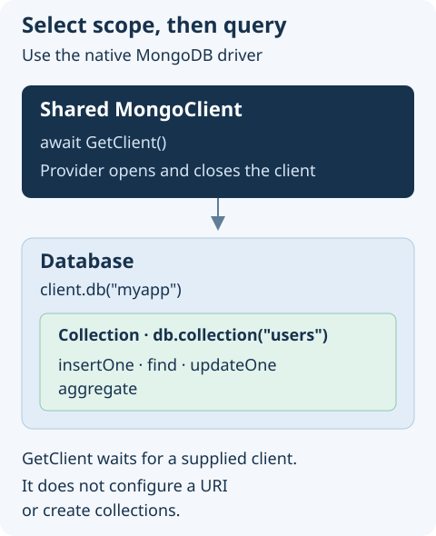

# Interface MongoDB Documentation

## Overview

Use the shared MongoDB connection without creating a client in every module. `GetClient()` returns the native [MongoClient](https://github.com/mongodb/node-mongodb-native); queries, cursors, indexes, and transactions use the MongoDB driver's API.

## Choose a database task

- [Read and write documents](#crud-operations) for application records.
- [Aggregate records](#aggregation-pipelines) for grouped counts and reports.
- [Create indexes](#indexes) for query performance and uniqueness constraints.
- [Understand client ownership](#getclient) before adding connection or shutdown code.



The interface does not configure a URI, start MongoDB, or define a data model. Configure an implementing module and a reachable MongoDB deployment before running the examples. The examples use the `myapp` database and `users` collection; use disposable data when trying writes.

## Getting Started

Install the package in your project:

```bash
npm install @antelopejs/interface-mongodb
```

## `GetClient`

The `GetClient` function retrieves the initialized MongoDB client instance. This is the main entry point for all MongoDB operations.

```typescript
import { GetClient } from "@antelopejs/interface-mongodb";

async function example() {
  const client = await GetClient();
  // The client is a standard mongodb MongoClient instance
}
```

The function returns a `Promise<MongoClient>` resolved by the implementing module. It waits if no client has been supplied; it is not a connectivity probe or a connection timeout.

Treat this client as shared: let the provider own connection setup and shutdown. Do not call `close()` after each query. Select the database explicitly with `client.db("myapp")`, and use the driver's error handling and timeout options for operations.

## CRUD Operations

Use the client to access databases and collections for standard create, read, update, and delete operations.

### Insert documents

```typescript
import { GetClient } from "@antelopejs/interface-mongodb";

async function createUser(name: string, email: string) {
  const client = await GetClient();
  const db = client.db("myapp");
  const collection = db.collection("users");

  const result = await collection.insertOne({
    name,
    email,
    createdAt: new Date(),
  });
  return result.insertedId;
}
```

### Find documents

```typescript
import { GetClient } from "@antelopejs/interface-mongodb";

async function findUsersByRole(role: string) {
  const client = await GetClient();
  const db = client.db("myapp");
  const users = db.collection("users");

  return users.find({ role }).toArray();
}
```

### Update documents

```typescript
import { GetClient } from "@antelopejs/interface-mongodb";

async function updateEmail(userId: string, newEmail: string) {
  const client = await GetClient();
  const db = client.db("myapp");
  const users = db.collection("users");

  const { ObjectId } = await import("mongodb");
  await users.updateOne(
    { _id: new ObjectId(userId) },
    { $set: { email: newEmail, updatedAt: new Date() } },
  );
}
```

### Delete documents

```typescript
import { GetClient } from "@antelopejs/interface-mongodb";

async function deleteUser(userId: string) {
  const client = await GetClient();
  const db = client.db("myapp");
  const users = db.collection("users");

  const { ObjectId } = await import("mongodb");
  await users.deleteOne({ _id: new ObjectId(userId) });
}
```

## Aggregation Pipelines

The MongoDB client supports aggregation pipelines for advanced data processing.

```typescript
import { GetClient } from "@antelopejs/interface-mongodb";

async function getUserCountsByRole() {
  const client = await GetClient();
  const db = client.db("myapp");
  const users = db.collection("users");

  return users
    .aggregate([
      { $group: { _id: "$role", count: { $sum: 1 } } },
      { $sort: { count: -1 } },
    ])
    .toArray();
}
```

## Indexes

Create indexes during an intentional setup or migration step, not on each request. A unique index on `email` rejects duplicates and can fail to build if existing data already contains them.

```typescript
import { GetClient } from "@antelopejs/interface-mongodb";

async function setupIndexes() {
  const client = await GetClient();
  const db = client.db("myapp");
  const users = db.collection("users");

  await users.createIndex({ email: 1 }, { unique: true });
  await users.createIndex({ role: 1, createdAt: -1 });
}
```

For the complete list of available operations, refer to the [MongoDB Node.js Driver documentation](https://www.mongodb.com/docs/drivers/node/current/).
